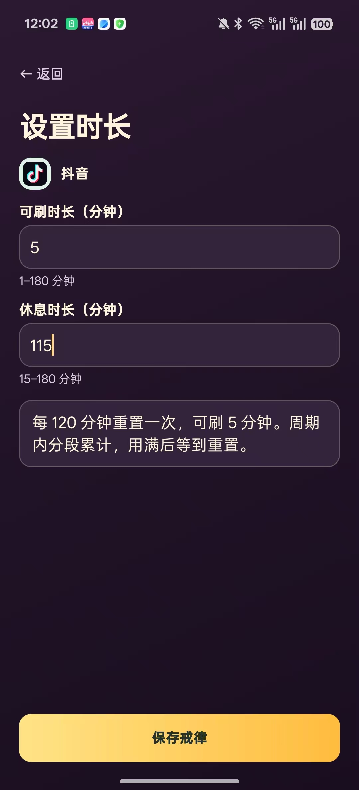

# 斩心魔

玩手机时，一个常见的困境是：**不是你不知道该停，而是到了该停的时候，很难按下停止键。**刷视频、玩游戏之前，明明想好“只用半小时”；时间到了，却又告诉自己：“再看一个，再玩一局。”

斩心魔 App 让你提前设好使用时长，到点后阻止继续使用，**把“该停了”，变成一次真正的暂停。**

这是一款**自愿使用的自我约束工具**。它不替你管理人生，而是帮助你守住自己定下的约定。它的价值不是让你“永远解不开”，而是让冲动与行动之间，多一次停顿、多一个选择。

**清醒时，给自己戴上自愿的镣铐；上头时，让它拽住想继续的手。**

## 下载安装

<!-- release-downloads:start -->
**[国内下载斩心魔 v0.3.17 签名 APK（Gitee）](https://gitee.com/grovecai/goule/releases/download/v0.3.17/goule-v0.3.17.apk)** · [GitHub 备用下载](https://github.com/grovecai/goule/releases/download/v0.3.17/goule-v0.3.17.apk)

Android 11 及以上 · [Gitee 发布说明](https://gitee.com/grovecai/goule/releases/tag/v0.3.17) · [SHA-256](https://gitee.com/grovecai/goule/releases/download/v0.3.17/goule-v0.3.17.apk.sha256) · [GitHub 原发布](https://github.com/grovecai/goule/releases/tag/v0.3.17)
<!-- release-downloads:end -->

## 它如何工作，有什么限制？

斩心魔通过必要的系统授权和后台运行，检测应用使用时长，并在超时后显示遮挡。**权限被撤销、程序停止运行或被卸载后，限制就可能失效。**作为普通第三方 App，最终控制权仍在你手里。

更彻底的技术方案是**定制 ROM，也就是修改手机操作系统，让系统直接执行限制**。这样更稳定、更难绕过，但开发、适配和安装成本也更高，并非普通 App 的实现方式。

## 立下第一条戒律

### 1. 安装并开始

在 Android 手机上打开下载的 APK，按系统提示安装。打开「斩心魔」，点击「立下第一条戒律」。

欢迎页截图展示的是旧版 20/30 分钟示例；v0.3.13 的新建默认值为可刷 5 分钟、休息 115 分钟。

### 2. 完成三步引导

首次引导按「无障碍服务 → 允许后台运行 → 风险行为拦截白名单」顺序进行，最后进入添加心魔。未完成时重开应用会回到当前步骤；已完成引导的用户升级后不强制重走。

1. **开启无障碍服务。** 阅读权限说明，再到系统设置开启「斩心魔」服务。回到应用，确认服务显示「已设置」。
2. **查看后台运行指引。** 按手机实际情况设置，点击「下一步：风险行为拦截白名单」。
3. **查看白名单指引。** 若手机管家提供该服务，将「斩心魔」加入白名单；没有该服务可直接继续。确认无障碍仍已开启，点击「继续添加心魔」。

遇到系统的「受限制的设置」提示，可以在无障碍设置页点击「遇到问题」。在 OPPO 上，系统授权后可能再弹出安全提示，选择「保持开启」即可继续。

OPPO/ColorOS 的「风险行为拦截」是系统自带「手机管家」中的一项服务，可能关闭「斩心魔」的无障碍服务。请在「手机管家」中找到该服务，将「斩心魔」加入其白名单。这是厂商提供的服务，并非 Android 通用设置；其他品牌和系统版本可能没有该服务或使用其他名称，以手机实际显示为准。若无障碍服务已被关闭，需手动重新开启；开关已开但显示「连接中断」时先关闭再开启，返回确认「已设置」。完成首次引导后，可在「设置 → 风险行为拦截白名单」单独查看指引，无障碍页与后台页也保留快捷入口。

### 3. 选好心魔，设定时长

挑一个最容易刷过头的 App，填写「可刷时长」和「休息时长」，点「保存戒律」。默认「刷 5 分钟，歇 115 分钟」，表示每 120 分钟重置一次 5 分钟额度。

| 设置时长并保存 | 在戒律页查看状态 |
| --- | --- |
|  |  |
| 保存前可以看到周期与额度说明。 | 保存后查看剩余可刷时长；右上角「＋」可以继续添加其他 App。 |

### 4. 用满额度，暂停一下

额度用满后，禁用页会挡住目标 App，并显示解禁时刻。点「回洞府」返回桌面；点「斩退心魔」打开系统最近任务，再上滑移除目标 App 卡片。你仍可以使用其他 App，同一周期内重新打开被禁用的 App，禁用页会再次出现。

## 它怎么知道该拦住哪个 App？

每条戒律使用独立的固定周期，周期长度为「可刷时长＋休息时长」。例如 **「刷 10 分钟，歇 120 分钟」** 就是每 130 分钟重置一次 10 分钟额度；「刷 20，歇 30」则每 50 分钟重置。各 App 的周期起点、累计量和重置时间独立。

1. **只累计前台使用时间。** Android 无障碍服务报告当前前台 App 的切换。斩心魔在目标 App 位于前台且屏幕可交互时累计时长，切出或锁屏就暂停。刷了 5 分钟后短暂离开，再打开时仍只剩 5 分钟。
2. **用满额度就拦住触摸。** 斩心魔记下解禁时刻，用禁用页覆盖目标 App 的交互区域。提前重新打开它，禁用页仍会出现。你仍可以返回桌面、使用其他 App。每个 App 的额度和禁用时间独立计算。
3. **固定到点一次重置。** 从首次使用起每 130 分钟重置，周期内用满就禁用至周期结束，没用满也在同一时刻刷新，剩余不结转。切到别处或锁屏不扣使用额度，周期照常经过。重新打开和闲置不会移动重置时间，额度不逐秒增长。

## 权限与隐私

窗口内容读取保持关闭，戒律和用量保存在手机上。你可以随时在系统设置关闭无障碍服务，戒律会暂停执行。

## 功能与验证范围

每个目标 App 独立计时与按固定周期刷新，列表和详情显示剩余可刷时间。额度用满后显示禁用页，修改戒律保留本轮用量、额度和原截止。首次使用提供三步引导，服务关闭或连接中断时显示恢复提示。

禁用页提供戒律长老、锅要糊了、摸鱼警报、挂科预警、拯救网瘾少年、亲妈催婚六套内置主题，支持固定、随机和多个自定义图片/台词主题，以及预览与管理。

当前自动检查包含 Python 46 项、Debug/Release 各 58 项单元测试及 Lint/构建；此前功能构建在 Android 15/API 35 模拟器通过十一组回归。OPPO PLJ110（Android 16、ColorOS V16.1.0）的原签名覆盖安装、数据保留、启动与服务绑定已有记录；正式版本包的发布验收与功能构建的真机测试分别记录。

ColorOS 仍可能撤销无障碍权限，重启或清理后需检查服务并按提示恢复；白名单指引不代表已解决系统撤权。来电挂断后的禁用页自动恢复仍有已知问题；低电量系统容器修复的再次自然触发、新主题真实用满/自然到期、完整长周期与更多机型等仍待验证。详见 [v1.0.0 发布说明](docs/release-v1.0.0.md)、[验证手册](docs/verification.md)与[逐项真机结果](docs/oppo-regression-2026-11-11.md)。

## 开发与验证

在仓库根目录运行 `./scripts/check`，需要 Bash、Git、Python 3、JDK 17 和 Android SDK 35。查看 [Android 设计](docs/android-design.md)、[交互设计](docs/interaction-design.md)、[实施计划](docs/implementation-plan.md)和[验证手册](docs/verification.md)。

本机只推送 GitHub；Actions 自动将 main 及新发布的发行版同步到 Gitee。配置及验收步骤见 [发布流程](docs/publishing.md)。

每日北京时间 08:17 有应用或构建代码更新时自动原签名发布；阶段性发布可在 GitHub Actions 的 `Publish Android release` 手动触发。纯文档更新不产生新版本。
